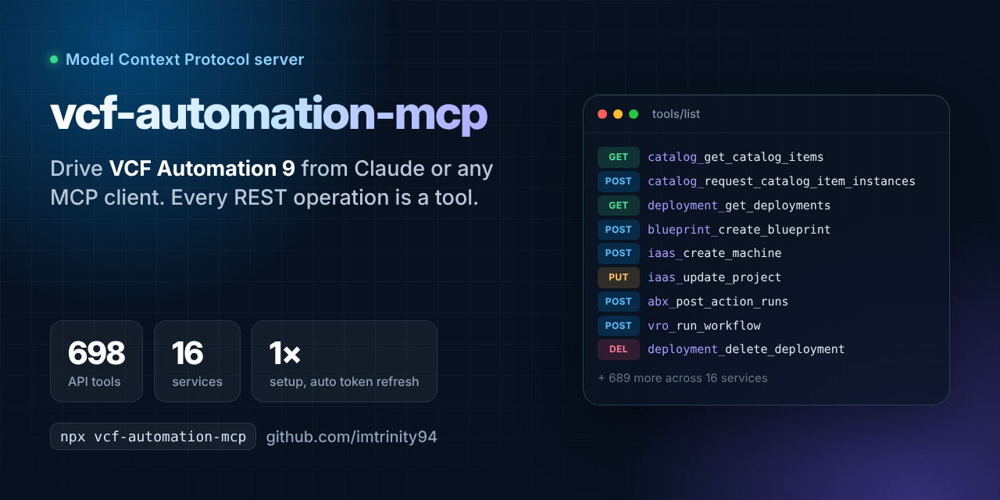

# vcf-automation-mcp



MCP server for **VCF Automation 9**, for both **VM Apps** and **All Apps** organizations. Every REST operation the org exposes becomes one MCP tool, generated straight from the OpenAPI specs that VCF Automation serves for that org type:

- **VM Apps org: 698 tools** across 16 services
- **All Apps org: 421 tools** across 12 services

Both counts include 2 Event Broker subscription calls that the published specs leave out (see [Event Broker subscriptions](#event-broker-subscriptions)).

Sister project of [vcf-orchestrator-mcp](https://github.com/imtrinity94/vcf-orchestrator-mcp).

## VM Apps and All Apps orgs

The two org types expose different API sets, so the server loads the tool catalogue that matches the org it talks to. Each server entry in your MCP client is **one org**: its own `VCFA_ORG`, its own service account and its own token chain. To work with both kinds of org, add one entry per org (see [step 3](#3-add-it-to-your-mcp-client)).

The org type comes from, in this order:

1. `VCFA_ORG_TYPE` (`vm-apps` or `all-apps`), if set
2. the type `setup --org-type` stored for that org in the token file
3. `vm-apps`

Configs from before 1.0.0 have neither, so they keep loading the VM Apps tools exactly as before.

## Services and tools

| Service key | VM Apps | All Apps | API |
|---|---:|---:|---|
| `abx` | 33 | – | ABX: actions, versions, secrets, action runs, flows |
| `approvals` | 11 | 15 | Approvals and work items |
| `metrics` | 5 | – | Deployment Metric (aggregator) and deployment limits |
| `blueprint` | 40 | 33 | Blueprint / cloud templates: create, validate, version, release, provision |
| `catalog` | 45 | 30 | Catalog items, sources, content sharing, requests, icons, notifications (pricing on VM Apps) |
| `deployment` | 38 | 36 | Deployments, resources, day-2 actions, requests |
| `policy` | 9 | 12 | Policies and policy types |
| `form` | 42 | 38 | Custom Forms (All Apps also: custom resource types and resource actions) |
| `content` | 11 | 11 | Content Gateway (content sources, source control) |
| `eventbroker` | 9 | 9 | Event Broker: events, topics, audit, subscriptions (list, create/update, get, delete) |
| `iaas` | 265 | 13 | Provisioning Service (IaaS). VM Apps: cloud accounts, zones, mappings, networks, storage, machines. All Apps: integrations, configuration properties, request tracker, certificates |
| `identity` | 53 | – | Identity Service (`/csp/gateway/am/api`) |
| `onboarding` | 27 | – | Onboarding (relocation) plans, resources, deployments |
| `vro` | 8 | 8 | Orchestrator Gateway: workflows and runs |
| `project` | 11 | 14 | Project Service (All Apps also: platform secrets and the RBAC auth context) |
| `provider` | 91 | 202 | Org management (`/cloudapi`): users, groups, roles, rights, sessions, tokens, service accounts. All Apps adds regions, zones, namespaces, content libraries, VM and storage classes, infra policies, defined entities |

Tool names follow `<service>_<operation>`, for example `deployment_get_deployments`, `catalog_request_catalog_item_instances`, `iaas_create_machine`, `abx_post_action_runs`, `vro_run_workflow`, `provider_query_users`. A service both org types share keeps the same tool names in both. Run `vcf-automation-mcp --list-tools --org-type all-apps` (or `vm-apps`) to see them all, or `--list-services` for the counts.

There are also two helper tools:

- `vcfa_connection_status`: shows the host, org, org type (and where it came from), auth mode in use, token expiry and tool counts. Pass `test: true` to log in now and make a test call: `GET /iaas/api/about` on a VM Apps org, `GET /rbac-service/api/auth-context` on an All Apps org.
- `vcfa_describe_operation`: returns the full nested request-body schema for any tool. Tool input schemas are summarised past three levels of nesting to keep `tools/list` small.

> **Hundreds of tools is a lot.** Some MCP clients cap or slow down with that many. Use `VCFA_SERVICES` to load only what you need, for example `VCFA_SERVICES=catalog,deployment,blueprint,abx,vro`.

## Quick start

Login works the same way as [vcf-orchestrator-mcp](https://github.com/imtrinity94/vcf-orchestrator-mcp). A one-time `setup` creates a VCF Automation **service account** and stores its refresh token on your machine. After that the server keeps its own login alive, so no token or password goes into your MCP config.

### 1. Install globally

```bash
npm i -g vcf-automation-mcp
```

The MCP config below runs the `vcf-automation-mcp` command, so the global install is required. If you only run setup with `npx`, there's no command for the client to start and Claude Desktop shows **"vcf-automation couldn't start. Its command wasn't found."**

### 2. Run setup once

```bash
vcf-automation-mcp setup --url "https://auto.vmw.lab" --org "vmapps-org" --user "admin" --name "Lab-VCFA-MCP" --role "Service Broker Administrator,Orchestrator Administrator,Assembler Administrator" --insecure
```

This exact command was tested end to end against a VCF Automation 9 VM Apps org (Windows 11, Claude Desktop).

For an **All Apps** org, add `--org-type all-apps` and use that org's name and one of its local users:

```bash
vcf-automation-mcp setup --url "https://auto.vmw.lab" --org "allapps-org-01" --org-type all-apps --user "admin" --name "Lab-VCFA-AllApps-MCP" --insecure
```

Setup stores the org type with the token, runs the API access check against the All Apps services, and prints a config block for that org. Run setup once per org; each org's token is kept separately in the same token file.

**Role names must exist in your org exactly as typed.** Each name becomes a `urn:vcloud:role:<name>` scope. A name the org doesn't have fails registration with HTTP 500, for example:

```
Registering service account failed: HTTP 500 ... Unable to find the following role(s) in org <id>: [Organization Administrator].
```

The error names only the roles it couldn't find, so drop or rename those and run setup again (the failed run creates nothing, so you can reuse the same `--name`). Role names vary per org: check **Access Control > Roles** in the tenant UI, or the role list in setup's first line (`1/5 Logged in as admin@vmapps-org (..., role ...)`). Leave `--role` out to copy the role of the user you log in with.

Setup asks for the password with a masked prompt. It uses it once to log in and never stores it. Then it:

1. Logs in as `user@org` at `/cloudapi/1.0.0/sessions`.
2. Registers the service account at `/oauth/tenant/{org}/register`.
3. Requests device authorization.
4. Grants the request as you.
5. Exchanges the device code for an access token and a refresh token.

It saves the refresh token to `~/.vcf-automation-mcp/tokens.json` (on Windows, `C:\Users\<you>\.vcf-automation-mcp\tokens.json`), checks which automation APIs the service account's role can reach, and prints the MCP config to paste.

| Option | Meaning |
|---|---|
| `--url` | VCF Automation URL |
| `--org` | Organization **name**, from the tenant URL `https://<fqdn>/tenant/<name>` |
| `--user` | **Local** org user, typed without `@org` |
| `--name` | Service account display name (under Access Control > Service Accounts) |
| `--role` | Comma-separated role names. Default: the role of the user you log in with |
| `--password` | Skips the prompt (the password then ends up in your shell history) |
| `--org-type` | `vm-apps` (default) or `all-apps`. Stored with the token, so the MCP config doesn't need `VCFA_ORG_TYPE` |
| `--client-id` | Uses a service account created in the UI instead; you approve the access request there. Use this for SSO-only orgs |
| `--insecure` | Accepts self-signed lab certificates |

> If the access check shows **403** for an API, the service account's role doesn't cover it. Give it a broader role (e.g. Organization Owner), then restart your MCP client.

### 3. Add it to your MCP client

Setup prints the block for the org it set up. With one VM Apps org and one All Apps org, the config has one entry each:

```json
{
  "mcpServers": {
    "vcfa-vmapps-org": {
      "command": "vcf-automation-mcp",
      "env": {
        "VCFA_HOST": "https://auto.vmw.lab",
        "VCFA_AUTH_MODE": "api-token",
        "VCFA_ORG": "vmapps-org",
        "VCFA_INSECURE": "true",
        "VCFA_SERVICES": "catalog,deployment,blueprint,project,abx,vro,eventbroker"
      }
    },
    "vcfa-allapps-org-01": {
      "command": "vcf-automation-mcp",
      "env": {
        "VCFA_HOST": "https://auto.vmw.lab",
        "VCFA_AUTH_MODE": "api-token",
        "VCFA_ORG": "allapps-org-01",
        "VCFA_ORG_TYPE": "all-apps",
        "VCFA_INSECURE": "true",
        "VCFA_SERVICES": "catalog,deployment,blueprint,project,vro,eventbroker"
      }
    }
  }
}
```

An existing entry named `vcf-automation` keeps working; the entry name is only a label.

The config file is at `~/Library/Application Support/Claude/claude_desktop_config.json` on macOS and `%APPDATA%\Claude\claude_desktop_config.json` on Windows. After editing it, quit Claude Desktop completely (on Windows, from the system tray) and reopen it.

**Windows: if the command still isn't found** after the global install, Claude Desktop isn't seeing the npm folder on its PATH. Run `where vcf-automation-mcp` and put the full path in `command`, with doubled backslashes:

```json
"command": "C:\\Users\\<you>\\AppData\\Roaming\\npm\\vcf-automation-mcp.cmd"
```

Without a global install, `"command": "cmd"` with `"args": ["/c", "npx", "-y", "vcf-automation-mcp"]` also works, but it's slower to start.

### 4. Check the connection

Ask your client to run `vcfa_connection_status` with `test: true`. A working setup shows `"modeInUse": "api-token"`, the right `orgType`, the token file under your home folder, and an HTTP 200 test call (`GET /iaas/api/about` for VM Apps, `GET /rbac-service/api/auth-context` for All Apps). On VCF Automation 9 the token endpoint resolves to `/tm/oauth/tenant/<org>/token`. With the `VCFA_SERVICES` lists above, 184 of the 698 VM Apps tools and 130 of the 421 All Apps tools load.

## Configuration

| Variable | Default | Description |
|---|---|---|
| `VCFA_HOST` | required | VCF Automation URL, e.g. `https://auto.vmw.lab` |
| `VCFA_ORG` | `System` | Organization **name**, e.g. `vmapps-org` or `allapps-org-01` (`System` means provider) |
| `VCFA_ORG_TYPE` | stored by setup, else `vm-apps` | `vm-apps` or `all-apps`: which API set (tool catalogue) to load |
| `VCFA_AUTH_MODE` | `auto` | `api-token`, `token`, `vcfa-cloudapi`, `vcfa` (see below) |
| `VCFA_API_TOKEN` | | Seeds a refresh-token chain yourself instead of running setup |
| `VCFA_CLIENT_ID` | | Service account client ID, if you seed a token yourself |
| `VCFA_TOKEN` | | Static access token; it expires and isn't renewed |
| `VCFA_USERNAME` / `VCFA_PASSWORD` | | For `vcfa-cloudapi` / `vcfa` |
| `VCFA_DOMAIN` | | Identity domain for `vcfa` (CSP) login |
| `VCFA_TOKEN_FILE` | `~/.vcf-automation-mcp/tokens.json` | Where rotated refresh tokens are kept |
| `VCFA_INSECURE` | `false` | Skip TLS verification (self-signed lab certificates) |
| `VCFA_READ_ONLY` | `false` | Load only GET operations; writes are also blocked at call time |
| `VCFA_SERVICES` | all | Comma-separated service keys to load |
| `VCFA_EXCLUDE_SERVICES` | | Comma-separated service keys to skip |
| `VCFA_TOOL_FILTER` | | Regex; load only tools whose name matches |
| `VCFA_CLOUDAPI_VERSION` | `9.1.0` | `Accept: application/json;version=` for `/cloudapi` calls |
| `VCFA_MAX_RESPONSE_CHARS` | `100000` | Responses longer than this are truncated |
| `VCFA_TIMEOUT_MS` | `120000` | Per-request timeout |

### Auth modes

The names and behaviour match vcf-orchestrator-mcp.

| Mode | How it logs in |
|---|---|
| `api-token` | Refresh token, plus client ID when known, posted to `/oauth/tenant/{org}/token` (falls back to `/tm/oauth/...`). VCF Automation **rotates** the refresh token on every use, so the server writes each new one to the token file before carrying on. Restarts keep working with no new setup |
| `token` | `VCFA_TOKEN` used as-is |
| `vcfa-cloudapi` | `POST /cloudapi/1.0.0/sessions` (then `/tm/cloudapi`) with Basic `user@org`, trying Accept versions 9.1.0 / 9.0.0 / 40.0. It stops at the first 401, so a wrong password counts only once towards the account lockout |
| `vcfa` | 8.x-style `/csp/gateway/am/api/login` then `/iaas/api/login`, for VM Apps orgs upgraded from Aria Automation 8 |
| `auto` | `api-token` if a token is set or stored, else `token`, else `vcfa-cloudapi` then `vcfa` |

Access tokens are renewed a minute before they expire, and once more after a `401`. There's no background timer: an idle server refreshes on its next call.

**One token chain per machine, per server.** Don't copy `tokens.json` between machines, and don't run two copies of this server against the same org at the same time (for example Claude Desktop and Claude Code). Whichever refreshes first invalidates the other's token, and the other gets `invalid_grant`; running `setup` again fixes it. This server keeps its own token file, separate from vcf-orchestrator-mcp's, so the two never break each other. Give each one its own service account.

## Calling conventions

- Path, query and header parameters are top-level arguments.
- Request bodies go in `body`: a JSON object, or a string for YAML/text endpoints.
- OData parameters drop the `$` because MCP clients reject `$` in argument names: `$top` becomes `top`, and likewise `skip`, `filter`, `select`, `orderby`, `count`.
- Many automation endpoints take an optional `apiVersion` query parameter.

## Event Broker subscriptions

The Event Broker spec published for VCF Automation 9 (VM Apps and All Apps orgs alike) has only two subscription operations: get one by ID, and delete. It has no way to list or create subscriptions, although the VCF Automation UI does both. The UI uses the same endpoints as Aria Automation 8.x, so this server adds them, for both org types, from a small hand-written supplement (`specs/supplements/Event Broker - Subscriptions (extra).json`):

| Tool | Request |
|---|---|
| `eventbroker_list_subscriptions` | `GET /event-broker/api/subscriptions` with `page`, `size`, `filter` (e.g. `type eq 'RUNNABLE'`) |
| `eventbroker_create_or_update_subscription` | `POST /event-broker/api/subscriptions`. Omit `id` to create; send an existing `id` to update |

A workflow subscription needs `name`, `eventTopicId` (from `eventbroker_get_all_event_topics`), `type: "RUNNABLE"`, `runnableType: "extensibility.vro"` and `runnableId` (the workflow ID). For an ABX action, use `runnableType: "extensibility.abx"` with the action ID. Optional fields are `blocking`, `timeout`, `priority`, `criteria`, `constraints.projectId` and `disabled`.

Because these two calls aren't in Broadcom's published API, their tool descriptions say so, and a future VCF Automation release could change them.

## Development

```bash
npm install
npm run generate   # specs/<org type>/*.json|yaml -> data/operations-<org type>.json
npm run build
npm test           # mock VCFA server + real MCP client over stdio
```

To refresh the specs, download each one from `https://<vcfa>/tenant/<org>/api-docs` of a VM Apps or an All Apps org, drop it into `specs/vm-apps/` or `specs/all-apps/`, then run `npm run generate`. The per-org-type file-to-service mapping lives at the top of `scripts/generate.mjs`; `specs/all-apps/_manifest.csv` lists where each All Apps spec was downloaded from.

## License

MIT
