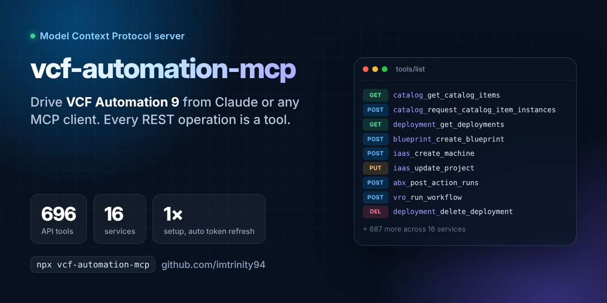

# vcf-automation-mcp



MCP server for **VCF Automation 9** (VM Apps organization). Every REST operation in the VCF Automation API set becomes one MCP tool: **696 operation tools** across 16 services, generated straight from the OpenAPI specs that VCF Automation serves at `https://<vcfa>/tenant/<org>/api-docs`.

Sister project of [vcf-orchestrator-mcp](https://github.com/imtrinity94/vcf-orchestrator-mcp).

## Services and tools

| Service key | Tools | API |
|---|---:|---|
| `abx` | 33 | ABX: actions, versions, secrets, action runs, flows |
| `approvals` | 11 | Approvals and work items |
| `metrics` | 5 | Deployment Metric (aggregator) and deployment limits |
| `blueprint` | 40 | Blueprint / cloud templates: create, validate, version, release, provision |
| `catalog` | 45 | Catalog items, sources, content sharing, requests, icons, notifications, pricing |
| `deployment` | 38 | Deployments, resources, day-2 actions, requests |
| `policy` | 9 | Policies and policy types |
| `form` | 42 | Custom Forms |
| `content` | 11 | Content Gateway (content sources, source control) |
| `eventbroker` | 7 | Event Broker: events, topics, audit, subscriptions |
| `iaas` | 265 | Provisioning Service (IaaS): cloud accounts, zones, mappings, networks, storage, machines |
| `identity` | 53 | Identity Service (`/csp/gateway/am/api`) |
| `onboarding` | 27 | Onboarding (relocation) plans, resources, deployments |
| `vro` | 8 | Orchestrator Gateway: workflows and runs |
| `project` | 11 | Project Service |
| `provider` | 91 | Provider Management / Access Control (`/cloudapi`) |

Tool names follow `<service>_<operation>`, for example `deployment_get_deployments`, `catalog_request_catalog_item`, `iaas_create_machine`, `abx_post_action_runs`, `vro_run_workflow`, `provider_query_users`. Run `npx vcf-automation-mcp --list-tools` to see them all.

There are also two helper tools:

- `vcfa_connection_status`: shows the host, org, auth mode in use, token expiry and tool counts. Pass `test: true` to log in now and call `GET /iaas/api/about`.
- `vcfa_describe_operation`: returns the full nested request-body schema for any tool. Tool input schemas are summarised past three levels of nesting to keep `tools/list` small.

> **About 700 tools is a lot.** Some MCP clients cap or slow down with that many. Use `VCFA_SERVICES` to load only what you need, for example `VCFA_SERVICES=catalog,deployment,blueprint,abx,vro`.

## Quick start

Login works the same way as [vcf-orchestrator-mcp](https://github.com/imtrinity94/vcf-orchestrator-mcp). A one-time `setup` creates a VCF Automation **service account** and stores its refresh token on your machine. After that the server keeps its own login alive, so no token or password goes into your MCP config.

### 1. Run setup once

```bash
npm i -g vcf-automation-mcp
vcf-automation-mcp setup --url "https://auto.vmw.lab" --org "vmapps-org" --user "<local-admin>" --name "Lab-VCFA-MCP" --role "Organization Owner" --insecure
```

Setup asks for the password with a masked prompt. It uses it once to log in and never stores it. Then it:

1. Logs in as `user@org` at `/cloudapi/1.0.0/sessions`.
2. Registers the service account at `/oauth/tenant/{org}/register`.
3. Requests device authorization.
4. Grants the request as you.
5. Exchanges the device code for an access token and a refresh token.

It saves the refresh token to `~/.vcf-automation-mcp/tokens.json` (on Windows, `C:\Users\<you>\.vcf-automation-mcp\tokens.json`), checks which automation APIs the service account's role can reach, and prints the MCP config to paste.

| Option | Meaning |
|---|---|
| `--url` | VCF Automation URL |
| `--org` | Organization **name**, from the tenant URL `https://<fqdn>/tenant/<name>` |
| `--user` | **Local** org user, typed without `@org` |
| `--name` | Service account display name (under Access Control > Service Accounts) |
| `--role` | Comma-separated role names. Default: the role of the user you log in with |
| `--password` | Skips the prompt (the password then ends up in your shell history) |
| `--client-id` | Uses a service account created in the UI instead; you approve the access request there. Use this for SSO-only orgs |
| `--insecure` | Accepts self-signed lab certificates |

> If the access check shows **403** for an API, the service account's role doesn't cover it. Give it a broader role (e.g. Organization Owner), then restart your MCP client.

### 2. Add it to your MCP client

```json
{
  "mcpServers": {
    "vcf-automation": {
      "command": "vcf-automation-mcp",
      "env": {
        "VCFA_HOST": "https://auto.vmw.lab",
        "VCFA_AUTH_MODE": "api-token",
        "VCFA_ORG": "vmapps-org",
        "VCFA_INSECURE": "true",
        "VCFA_SERVICES": "catalog,deployment,blueprint,project,abx,vro,eventbroker"
      }
    }
  }
}
```

The config file is at `~/Library/Application Support/Claude/claude_desktop_config.json` on macOS and `%APPDATA%\Claude\claude_desktop_config.json` on Windows.

## Configuration

| Variable | Default | Description |
|---|---|---|
| `VCFA_HOST` | required | VCF Automation URL, e.g. `https://auto.vmw.lab` |
| `VCFA_ORG` | `System` | VM Apps organization **name**, e.g. `vmapps-org` (`System` means provider) |
| `VCFA_AUTH_MODE` | `auto` | `api-token`, `token`, `vcfa-cloudapi`, `vcfa` (see below) |
| `VCFA_API_TOKEN` | | Seeds a refresh-token chain yourself instead of running setup |
| `VCFA_CLIENT_ID` | | Service account client ID, if you seed a token yourself |
| `VCFA_TOKEN` | | Static access token; it expires and isn't renewed |
| `VCFA_USERNAME` / `VCFA_PASSWORD` | | For `vcfa-cloudapi` / `vcfa` |
| `VCFA_DOMAIN` | | Identity domain for `vcfa` (CSP) login |
| `VCFA_TOKEN_FILE` | `~/.vcf-automation-mcp/tokens.json` | Where rotated refresh tokens are kept |
| `VCFA_INSECURE` | `false` | Skip TLS verification (self-signed lab certificates) |
| `VCFA_READ_ONLY` | `false` | Load only GET operations; writes are also blocked at call time |
| `VCFA_SERVICES` | all | Comma-separated service keys to load |
| `VCFA_EXCLUDE_SERVICES` | | Comma-separated service keys to skip |
| `VCFA_TOOL_FILTER` | | Regex; load only tools whose name matches |
| `VCFA_CLOUDAPI_VERSION` | `9.1.0` | `Accept: application/json;version=` for `/cloudapi` calls |
| `VCFA_MAX_RESPONSE_CHARS` | `100000` | Responses longer than this are truncated |
| `VCFA_TIMEOUT_MS` | `120000` | Per-request timeout |

### Auth modes

The names and behaviour match vcf-orchestrator-mcp.

| Mode | How it logs in |
|---|---|
| `api-token` | Refresh token, plus client ID when known, posted to `/oauth/tenant/{org}/token` (falls back to `/tm/oauth/...`). VCF Automation **rotates** the refresh token on every use, so the server writes each new one to the token file before carrying on. Restarts keep working with no new setup |
| `token` | `VCFA_TOKEN` used as-is |
| `vcfa-cloudapi` | `POST /cloudapi/1.0.0/sessions` (then `/tm/cloudapi`) with Basic `user@org`, trying Accept versions 9.1.0 / 9.0.0 / 40.0. It stops at the first 401, so a wrong password counts only once towards the account lockout |
| `vcfa` | 8.x-style `/csp/gateway/am/api/login` then `/iaas/api/login`, for VM Apps orgs upgraded from Aria Automation 8 |
| `auto` | `api-token` if a token is set or stored, else `token`, else `vcfa-cloudapi` then `vcfa` |

Access tokens are renewed a minute before they expire, and once more after a `401`. There's no background timer: an idle server refreshes on its next call.

**One token chain per machine, per server.** Don't copy `tokens.json` between machines, and don't run two copies of this server against the same org at the same time (for example Claude Desktop and Claude Code). Whichever refreshes first invalidates the other's token, and the other gets `invalid_grant`; running `setup` again fixes it. This server keeps its own token file, separate from vcf-orchestrator-mcp's, so the two never break each other. Give each one its own service account.

## Calling conventions

- Path, query and header parameters are top-level arguments.
- Request bodies go in `body`: a JSON object, or a string for YAML/text endpoints.
- OData parameters drop the `$` because MCP clients reject `$` in argument names: `$top` becomes `top`, and likewise `skip`, `filter`, `select`, `orderby`, `count`.
- Many automation endpoints take an optional `apiVersion` query parameter.

## Development

```bash
npm install
npm run generate   # specs/*.json|yaml -> data/operations.json
npm run build
npm test           # mock VCFA server + real MCP client over stdio
```

To refresh the specs, download each one from `https://<vcfa>/tenant/<org>/api-docs`, drop it into `specs/`, then run `npm run generate`. The file-to-service mapping lives at the top of `scripts/generate.mjs`.

## License

MIT
